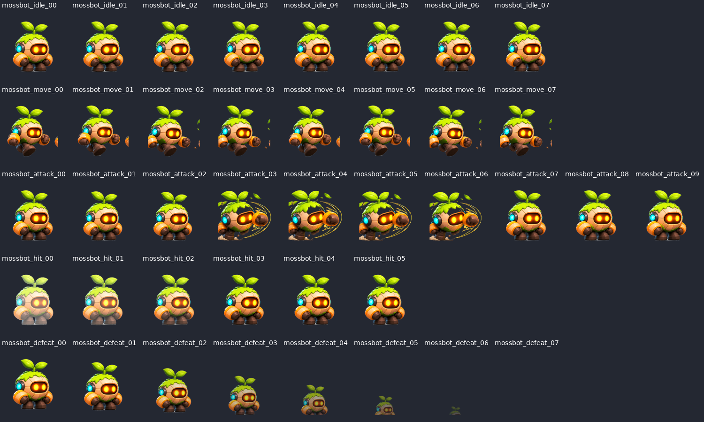
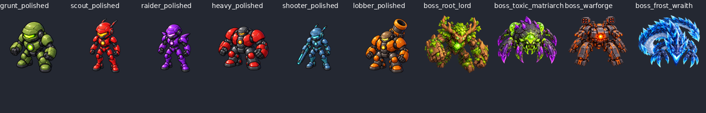

# Build 337 enemy artwork integration and validation

Branch: `feature/build337-environment-layouts`.
Environment baseline preserved: `78bed1b6b8d68f1a38277b95e0bdf322bbba920c`.
Implementation: `425e99fc98b45f7317a8d602e37ba8163dd98d55`.
Audit hardening: `cbfdfc97798b8c5fb75a3bcd9236d11488de5794` (no additional app-source changes).
Facing stability / targeted simulator recovery: `5d4474cde3a7d84a6e7db51896b4abc3f801a0f0`.
Status: integrated into normal gameplay; visual and source-art release gates remain open. Not visually approved.

## Asset inventory

The tracked native tree, catalog registration, generator/loader call sites and browser renderer references were audited. `build-327` was also inspected: its 40 loose Mossbot PNGs are the source of the 40 imported imagesets, not a second enemy. Additional tree checks of main, patch-1, patch-2 and integration/phase5-main-sync found no additional enemy-named image/model candidates absent from this branch. No new placeholder characters were generated.

| Character / entity | Source and animations present | Current native integration | Missing or remaining work |
| --- | --- | --- | --- |
| Mossbot / World 1 behavior 0 grunt | 40 universal Xcode imagesets: idle 8 @ 8 fps, move 8 @ 12 fps, attack 10 @ 15 fps, hit 6 @ 15 fps, defeat 8 @ 12 fps | Normal gameplay; all five motions. Horizontal facing, fixed square canvas, shared texture cache, complete art-only defeat copy | Source export defects below; no additional up/down/left directional sheets |
| Grunt, other worlds | `ArtAssets/grunt_polished.png`, one portrait | Existing `grunt_idle` alias resolves polished art. Existing procedural movement/hit/defeat presentation retained | No authored multi-frame sequences |
| Scout / behavior 1 | `ArtAssets/scout_polished.png`, one portrait | Existing `scout_idle` alias resolves approved portrait; correct native role retained | No authored multi-frame sequences |
| Raider / behavior 2 | `ArtAssets/raider_polished.png`, one portrait | Existing `raider_idle` alias; native role retained | No authored multi-frame sequences |
| Heavy / behavior 3 | `ArtAssets/heavy_polished.png`, one portrait | Existing `heavy_idle` alias; larger class silhouette retained | No authored multi-frame sequences |
| Shooter / behavior 4 | `ArtAssets/shooter_polished.png`, one portrait | Existing `shooter_idle` alias; weapon silhouette retained | No authored multi-frame sequences |
| Lobber / behavior 5 | `ArtAssets/lobber_polished.png`, one portrait | Existing `lobber_idle` alias; native mortar role retained | No authored multi-frame sequences |
| Root Lord | `ArtAssets/boss_root_lord.png`, one portrait | Existing `BossArtwork` install and breathing/core motion in authored sanctuary | No authored idle/move/attack/hit/defeat frame sets |
| Toxic Matriarch | `ArtAssets/boss_toxic_matriarch.png`, one portrait | Existing boss installation and procedural motion retained | No authored frame sets |
| Warforge | `ArtAssets/boss_warforge.png`, one portrait | Existing boss installation and procedural motion retained | No authored frame sets |
| Frost Wraith | `ArtAssets/boss_frost_wraith.png`, one portrait | Existing boss installation and procedural hover retained | No authored frame sets |
| Browser conscript, breacher, juggernaut, overwatch, phalanx, warden | Six `assets/enemies/enemy_*.png` portraits | Already referenced by `src/renderer.js`; not native SpriteKit entities or Xcode image sets | No approved native role mapping; do not substitute these unrelated characters |
| Browser hostile soldier, armored hostile, boss | `assets/unit-animation-atlas.png`, 1254×1254, 5×5 cells. Hostile rows 2, 3 and 4, with idle, two walk poses, fire, hit/death pose. Rows 0/1 are commander/friendly | Already used by `src/centralHQPrototype.js` | Browser-specific style/roles; no native mapping. Not a hidden Mossbot sheet |
| Browser combat sheet | `assets/visual144/combat-atlas.png`, 4×2 cells, hostile soldier/armored/boss plus friendly/environment elements | Existing `spriteCell` fallback in browser prototype | No native role mapping |
| 3D zombie sources | `assets/prototype4/Zombie-Soldier.fbx`, `Zombie-Scout.fbx`, `Zombie-Run.fbx`, `Zombie-Punch.fbx`, `Zombie-Death.fbx`, `Zombie-Attack.fbx` | Soldier/scout models and run/punch/death are referenced by `src/threeDPrototype.entry.js`; `Zombie-Attack.fbx` has no direct loader mapping there | FBX models/clips, not SpriteKit PNG sequences; no approved 2D export or native mapping |
| Legacy native prototypes | Tracked `ArtAssets/scout_idle.png` and `heavy_idle.png` (128×128); other generated `*_idle.png` files from `generate_enemy_art.py` / `generate_forest_art.py` | Polished aliases take precedence. Generator outputs remain fallback resources, not replacements for approved portraits | No need to regenerate approved artwork; a broken bundle would expose fallback art, so audit requires all polished portraits |

[Machine-readable inventory, dimensions, catalog checks and SHA-256 per frame](asset-inventory.json).

## Source-frame findings

All 40 expected files exist, decode as 512×512 RGBA and have correctly registered universal imagesets. A Git blob comparison verified that every imported PNG is byte-for-byte identical to its loose upload on `build-327`; no approved source pixels were overwritten. No numbered frame is missing. Repeated poses provide holds/cycles: idle has five distinct decoded images, movement four, attack eight, hit five and defeat eight.

- Movement 00–07: the left arm is abruptly clipped at x=56. Unrelated fragments of another sprite occur beyond x=416. Runtime rendering masks that unrelated right strip **without** scaling or recentering the 512×512 canvas; approved source files remain unchanged. Lost arm pixels cannot be reconstructed from the supplied export.
- Attack 03–06: the body/effect abruptly cuts off at the left boundary x=54/56. Corrected artist exports are required for a clean silhouette.
- Defeat 03–06: the collapsing sprite intersects the bottom canvas edge. Confirm whether that sinking/cropping is intentional; a clean collapse export is needed if it is not.
- Defeat 07 is fully transparent. It remains the terminal disappearance frame; it is not treated as an accidentally missing texture.
- Only a right-facing three-quarter character is supplied. Left-facing motion uses horizontal mirroring. There is no approved north/south sheet to integrate.

These defects prevent a 9.5/10 source-art claim even if playback succeeds. No generated replacement or unrelated character was substituted.

## Implementation and gameplay preservation

Mossbot loads all five complete frame sets once, warms the GPU textures before combat, and caches unavailable sequences. No image lookup or texture decoding occurs on steady-state locomotion updates. If the bundle is incomplete, the existing polished grunt stays in use.

The visible idle body is about 52 world points tall within a 68-point square canvas, compared with the 70-point player portrait. Ground anchoring and health-bar height account for the source transparency. Existing native portraits now preserve their image aspect ratios.

Hit reactions interrupt attacks; locomotion cannot interrupt either. Rapid hits do not continually restart the same hit action. A one-shot resumes the latest desired locomotion immediately on completion. Travel updates cannot flip a hit/punch mid-playback, and near-contact movement jitter does not reverse facing; actual successful contact attacks can still face their target. Attack playback begins only after an actual contact-damage event lowers pilot health or reactor integrity, and it never changes damage timing or amount. All damage feedback paths reach the Mossbot hit controller through the existing common hit renderer.

Killed enemies leave the authoritative array immediately, with the same rewards and collision cleanup. A separate sprite plays all eight defeat frames over 0.667 seconds and then removes itself. The old static defeat echo is suppressed for animated Mossbots. Room transitions discard any remaining art-only corpse, preventing ghosts in the next environment.

No HP, speed, radius, attack cadence, damage, enemy-type schedule, rewards or difficulty values were changed. The four authored layouts, family floor/prop selection, forward camera, reactor objective and portal positions remain intact. The old `-reviewBuild337Mossbot` dependency was removed; a separate corridor-exit capture flag only selects that QA scene.

## Validation

- Local source sanity checks and 51 Python tests passed, including actual PNG/catalog registration checks.
- Pure Swift tests cover animation timing/counts, hit/attack priority, repeated-hit behavior, terminal defeat ownership and transition back from completed one-shots.
- [Hardened audit/compile run](https://github.com/JPaulus04/invasion-front-app/actions/runs/43723607704): **passed**, including all 51 Python tests, Swift animation policy, room rules, environment/navigation checks and compilation. Simulator startup intentionally skipped.
- [Initial compile/rules run](https://github.com/JPaulus04/invasion-front-app/actions/runs/43723182940): **passed**: compilation, animation policy, actual asset checks, 50 Python tests and room/environment rules at the implementation revision. The later audit hardening adds CRC/decoded-length rejection and a 51st test.
- [Initial continuous video milestone](https://github.com/JPaulus04/invasion-front-app/actions/runs/43723510145): **failed before app install/launch**. The pre-existing iPhone 17 Pro simulator did not finish boot readiness within 210 seconds. Downloaded artifact `14165957481` contains device identity, the timeout diagnostic and a successful build log, with no gameplay screenshots/video.
- [Final routine validation](https://github.com/JPaulus04/invasion-front-app/actions/runs/43724566709): **passed** at `5d4474cde3a7d84a6e7db51896b4abc3f801a0f0`, including compilation, 51 Python tests, animation/facing policy and existing geometry/navigation checks. Simulator startup intentionally skipped.
- [One targeted recovery](https://github.com/JPaulus04/invasion-front-app/actions/runs/43724609382): **failed before app installation/launch**. Downloaded artifact `14166044210` and inspected its manifest, failure diagnostic and startup probes. Fresh device `7158C273-3857-4991-A1E0-8E0A99F445B5` timed out in `bootstatus` after 240 seconds; device-list, launch-service and simulator-log probes also timed out. No gameplay video or screenshots were produced. The setup used the repository’s tested `fresh_simulator(..., controlled=True)` lifecycle: one new iPhone 16 Pro/iOS 18.5 device, cold-RPC readiness and positive app-registration checks, with no outer startup/gameplay retry. This targeted the pre-existing-device migration failure; the runner family was unchanged. No further infrastructure retry was attempted. A new `review=enemies` workflow input records a single continuous simulator video. It stages real spawned entities through spawn, idle, production pursuit, contact damage, rifle damage and kill cleanup, then crowded survival, defense and the Root Lord environment. The fixture is DEBUG-only and explicitly is not a balance or full-campaign test. Its trace must contain all ten stages and all five controller motions, but trace success alone cannot grant visual approval.

## Visual evidence and quality assessment

Reviewed all 40 original source frames and the six native portraits/four bosses in the contact sheets above. Those are **asset previews, not gameplay screenshots**. Both simulator artifacts were downloaded and reviewed; neither contains a gameplay frame or video. Old environment screenshots from the prior task predate normal-gameplay enemy activation and cannot validate this integration.

- [Initial boot-failure artifact](https://github.com/JPaulus04/invasion-front-app/actions/runs/43723510145/artifacts/14165957481)
- [Disposable-device recovery diagnostics](https://github.com/JPaulus04/invasion-front-app/actions/runs/43724609382/artifacts/14166044210)
- [Persistent failure summary and compiled-binary provenance](validation-diagnostics.json)

The source style is cohesive with the existing cartoon roster, and the code provides a consistent canvas/ground anchor and guarded state transitions. However, visible source clipping is below the requested production standard, and simulator failure leaves normal-gameplay scale, state transitions, attack readability, defeat playback and crowd performance unverified. **No numerical score, 9.5/10 claim, or gameplay visual approval is assigned.**

## Readiness and remaining checks

**Build 337 is not complete or approved for release consideration.** The implementation is a candidate for internal TestFlight gameplay verification after explicit approval, with the checklist below. Corrected source exports are still needed for movement 00–07 and attack 03–06, plus confirmation/correction of the bottom-clipped defeat poses. There are no missing numbered Mossbot frames, but asset completeness does not establish clean artwork.

Other native roles and bosses have no approved authored frame sets beyond their static portraits, so their existing procedural presentation remains in place. Browser characters/atlases and FBX models were not substituted into native roles. A sustained campaign and target-device frame-time/memory check remain necessary; cached textures and a staged fixture do not prove performance.

No merge into main or TestFlight upload was performed. The three implementation/audit SHAs are recorded at the top; the final documentation commit contains this report and does not change app source.

## Device verification checklist

1. Launch normal World 1 gameplay without capture/review arguments. Verify initial materialization uses Mossbot immediately, then idle, pursuit and left/right facing.
2. Apply rifle, orbit/blades, chain, explosion, burn and terrain damage. Check hit visibility and prompt resumption, without a reaction continually restarting under rapid hits.
3. Observe successful pilot/reactor contact attacks and immunity windows. Animation must not cause extra damage or change attack cadence. Verify one-shot facing stays stable while contact corrections occur.
4. Kill a normal and final-room enemy. Verify immediate combat/reward removal, a full eight-frame defeat visual, correct orientation/ground anchor, and no ghost carried through a room transition.
5. Run crowded room-6/9/17 survival and room-12 reactor defense. Inspect scale, HUD/objective overlap, clipped source edges, texture flicker, and portrait class readability.
6. Compare the player, new grunt, six native role portraits, props, portal, reactor and Root Lord. Profile frame time and memory on a compact iPhone and an iPad; a simulator video is not an Instruments performance trace.
