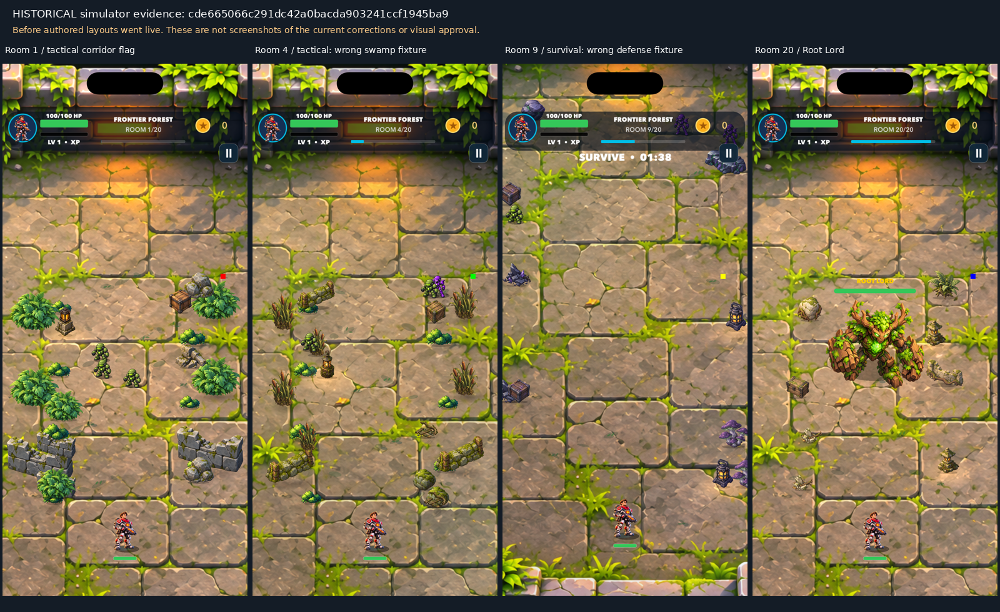
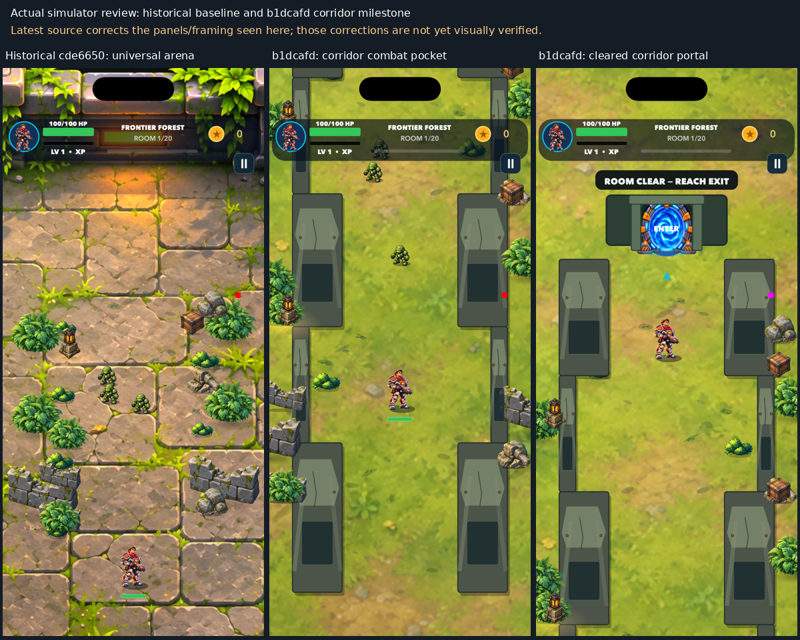

# Build 337 environment validation

Branch: `feature/build337-environment-layouts`.
Handoff: `1ad7602784dc45fde8f44c5916fd54d1277f9673`.
Latest gameplay revision: `6991326d195184fedd6ade737c66d87e9c91b779`.
Latest actual simulator capture revision: `b1dcafd0c904c711b4006d8fd09f42bcbab4e57b` (two corridor frames only).

## Corrections

- Retained the approved 13×38, 33×29, 27×27 and 37×32 player-width layouts for corridor, courtyard, defense and Root Lord respectively.
- Activated solid corridor shoulders with two wider combat pockets. The same rubble rectangles drive rendering, swept player collision, enemy navigation and spawn exclusion. The central entry-to-portal route stays clear.
- Centralized environment artwork identity on the live encounter. Both scenery systems now use ruined outpost, swamp basin, toxic caves and boss sanctuary families; props no longer follow the obsolete room-number rotation.
- Fixed the floor painting frame to 1100×1650 world points, centered on the room. Aspect-preserving coverage no longer derives its density from device dimensions. This uses the existing authored paintings without repeating them as seamless tiles.
- Replaced the oversized generic corridor panel treatment identified in actual captures with aspect-preserving authored ruined-wall courses, clipped to the collision shoulders. Removed procedural portal-approach marks when an authored floor is present.
- Added forward camera space for corridor traversal and Root Lord approaches; open survival and defense retain centered tracking. A new geometry assertion checks boss name/health headroom on approach.
- Moved decorative cutouts to the outer boundary instead of presenting walk-through wall silhouettes inside the open combat field.
- Preserved the authored corridor far-wall gate and entry positions. Extended the portal masonry to its threshold while preserving the existing top extent, closing the visible gap above the corridor shoulders. Placed the Root Lord at the authored boss staging objective.
- Corrected reactor placement: the previous `extractionPosition(near:)` helper intentionally selects a point at least 43 points away from its input. World 1 defense now uses its exact authored objective directly. Existing grounded collision and depth occlusion remain active.
- Timed encounters now sample arrivals around the whole arena; flank overrides cannot move enemies into corridor walls. Corridor spawn candidates have safe center-route fallbacks.
- Corrected five-frame review fixtures: the swamp frame opens actual survival room 6; the caves frame opens actual reactor-defense room 12. The second corridor frame reviews its cleared far-wall portal. Other captures retain production encounter construction.
- Enforced bundled family artwork and distinct scene identity pixels in focused review. Stale home screens and a reused corridor combat frame cannot pass as the corridor exit. Added a synthetic validator regression test; synthetic images are not gameplay evidence.

## Commits

| SHA | Change |
| --- | --- |
| `3c33be0a0b5260fcbf5c13820ecd2a58b80085fc` | Environment geometry, family selection, objective review, floor density and navigation tests |
| `fd858ff0f87ba3e7b30b3df0c0f392114086bed3` | Exact reactor anchor and terrain-safe flank arrivals |
| `b1dcafd0c904c711b4006d8fd09f42bcbab4e57b` | Distinct corridor-exit identity and stale-frame regression test |
| `7273f35689be235742280b63112e506b1142415c` | Screenshot-driven authored masonry, forward camera space, tighter fixed floor frame and removal of fallback marks |
| `6991326d195184fedd6ade737c66d87e9c91b779` | Connect portal masonry to the corridor threshold, preserving headroom |

## Evidence reviewed

[Historical five-frame success](https://github.com/JPaulus04/invasion-front-app/actions/runs/43666564141), revision `cde665066c291dc42a0bacda903241ccf1945ba9`: downloaded and inspected all five actual screenshots. They show the former universal stone floor, oversized paving and old capture schedule. These predate live authored layouts. The frame named swamp is room 4 tactical; the frame named caves is room 9 survival. Neither proves the new courtyard or reactor environment.

[Handoff validation](https://github.com/JPaulus04/invasion-front-app/actions/runs/43680764511): **failed**, not passed. Compilation succeeded. App launch returned a PID, but the first gameplay `simctl io … screenshot` timed out after 45 seconds. Subsequent device-list and diagnostic screenshot commands each timed out after 25 seconds. Downloaded artifact `14148477899` contains the successful build log, prelaunch simulator home screen and failure diagnostic, with no gameplay captures. No visual approval can be inferred from that run.

The later historical successes at [43680104007](https://github.com/JPaulus04/invasion-front-app/actions/runs/43680104007) and [43680097886](https://github.com/JPaulus04/invasion-front-app/actions/runs/43680097886) skipped visual capture. They are compile evidence only.

## Automated validation

- Local source sanity check passed.
- Local 49-test Python suite passed, including simulator failure handling and the new smoke-frame identity regression.
- All 36 expected family-specific World 1 PNGs (three floors and six props per family) are present in the checkout.
- Local audit checked 120 PNGs and passed applicable dimensions/transparency checks. That audit does not enforce complete World 1 asset presence; focused launch explicitly requires its chosen floor and props.
- [Routine validation at fd858ff](https://github.com/JPaulus04/invasion-front-app/actions/runs/43681597175): passed compilation, Python tests, existing room rules and new environment tests; simulator startup intentionally skipped.
- The environment tests exercise all four artwork identities, scheduled survival/defense encounters, a complete corridor walk to the portal, lateral pocket clearance versus blocked connectors, actual navigation from both pockets to the entrance, and safe entry/portal framing at 320×568, 393×852 and 768×1024 viewports.
- [Focused recovery milestone at b1dcafd](https://github.com/JPaulus04/invasion-front-app/actions/runs/43681784269): **failed overall**, after compilation and automated checks passed. Produced two actual 1206×2622 corridor screenshots. Termination before the swamp capture timed out after 20 seconds; the workflow correctly stopped because it could not guarantee capture isolation. No further simulator retry was started.
- Both downloaded corridor PNGs independently passed the stricter scene-identity validator locally (566 and 576 sampled battlefield colors). The workflow did not reach its five-frame validator because capture failed first. A partial pair is not a five-frame pass.
- [Final compile/rules validation at 6991326](https://github.com/JPaulus04/invasion-front-app/actions/runs/43682888563): **passed**: compilation, all 49 Python tests, room rules and environment/navigation tests including the boss headroom assertion. Simulator capture and artifact upload were intentionally skipped.

## Fresh screenshot review and limits

[Download recovery diagnostics and screenshots](https://github.com/JPaulus04/invasion-front-app/actions/runs/43681784269/artifacts/14148692215).

Full-resolution evidence: [corridor combat](build337-review/b1dcafd-corridor-combat.png) and [corridor exit](build337-review/b1dcafd-corridor-exit.png).

The actual pair establishes that the authored elongated route and widened pockets render in the live scene, the family-specific floor replaces the old universal stone arena, and the portal is visible with its instruction below the HUD. It also exposes large generic gray obstacle panels, soft enlarged ground artwork, repeated fallback path marks and a gap above the shoulders at the portal wall. Those findings led to `7273f35` and `6991326`; their resulting appearance is **not yet visually validated**. Source floor paintings are 512×768, so final ground sharpness still needs device review after reducing their enlargement. The evidence also shows a distant enemy beneath the translucent HUD; forward framing was adjusted, but full traversal/HUD clearance remains a device check.

There are **no fresh courtyard, defense or Root Lord captures**. The recovery stopped before launching those fixtures. Existing historical files with swamp/caves names cannot fill that gap because they use the obsolete room schedule. Reactor placement is verified in source and asserted in the corrected fixture, not visually approved.

## Release decision

**Hold release consideration.** No 9.5/10 score or visual approval is claimed. The latest source needs a fresh visual review of all four environments and real combat/transition checks. Automated geometry/navigation and compilation cannot establish the requested production visual quality.

The simulator limitation and exact device-verification steps are documented below. After explicit user approval, an internal TestFlight build would be suitable for gathering this missing evidence; it should not be presented as release-ready. Nothing was merged into main or uploaded to TestFlight.

## Required device verification before release consideration

1. **Corridor:** walk from entry through both pockets to the unlocked far-wall portal; dodge against each shoulder; verify melee and ranged arrivals, flank waves and doorway transition. Confirm no enemies remain trapped and no floor strips or HUD overlaps appear while following the player.
2. **Courtyard:** inspect the swamp identity at room 6, four-sided arrivals, edge camera clamps and pickup readability; finish the timer, extract, and verify room 7 resets to the corridor rather than retaining survival scenery.
3. **Reactor defense:** inspect room 12, with the reactor at the exact authored room center. Walk around its grounded footprint and inspect foreground/background occlusion, integrity and countdown while all approaches are active. Exercise both reactor-secured and reactor-lost outcomes and continue into room 13.
4. **Root Lord:** approach the authored staging point in room 20; inspect boss scale, upper-screen/HUD clearance, environmental composition, telegraphs, movement and victory flow.
5. **Scale and transitions:** repeat representative checks on a compact iPhone and an iPad. Traverse 6→7, 9→10, 12→13 and 19→20; interrupt/resume a timed room. Confirm fixed ground density and correct entry, camera and objective positions after each transition.

Pure geometry checks do not establish encounter balance, complete campaign playability, natural art repetition, animation performance or a 9.5/10 visual standard. Those remain evidence-dependent release gates.
