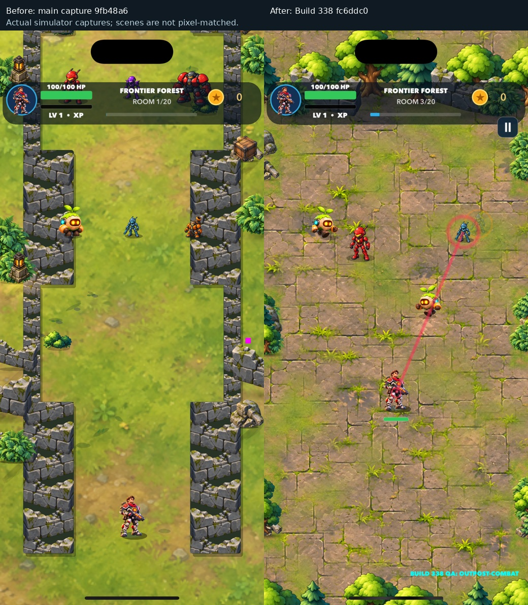
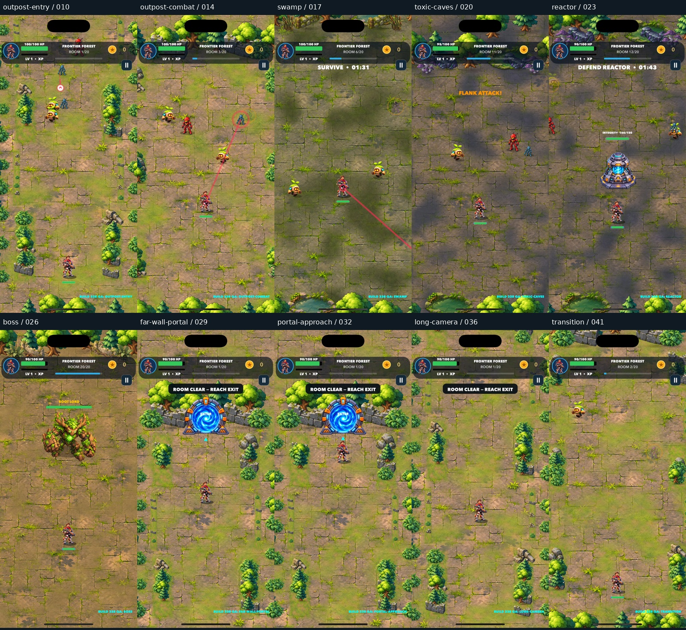

# Build 338 — unified World 1

The approved overgrown stone-and-forest direction is restored through one deterministic renderer, fixed-scale derived paving, natural forest/ruin boundaries, four cohesive themes and the exact transparent round portal.

[Full corrections, asset ledger, validation outcomes and release recommendation](REPORT.md) · [PR #11](https://github.com/JPaulus04/invasion-front-app/pull/11)

The final environment milestone [43788243531](https://github.com/JPaulus04/invasion-front-app/actions/runs/43788243531) passed; all ten actual simulator views were reviewed. The full dynamic campaign remains unverified after two pre-launch simulator timeouts. **Hold TestFlight readiness; no merge/upload or 9.5/10 certification.**

The before capture is `9fb48a6` on main, predating the baseline `3987f2c` portal cleanup. The after capture is `fc6ddc0`; subsequent changes correct simulator fixtures and the resolved-reactor HUD. Comparisons are not pixel-matched scene states. Full-resolution originals are linked in the report.

Asset provenance: [ground source/output hashes](ground-provenance.json), [approved portal baseline](approved-assets.json), [derived-material source preview](derived-materials-source-preview.jpg). The source preview is not gameplay evidence.
