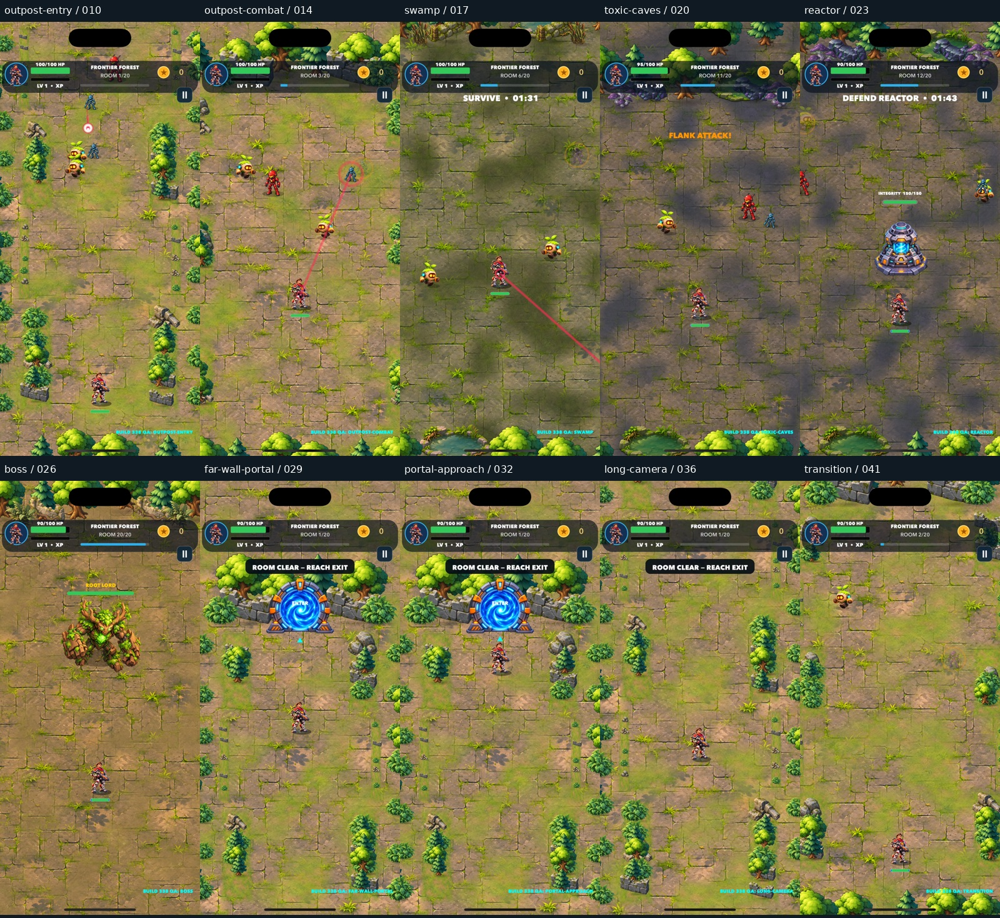
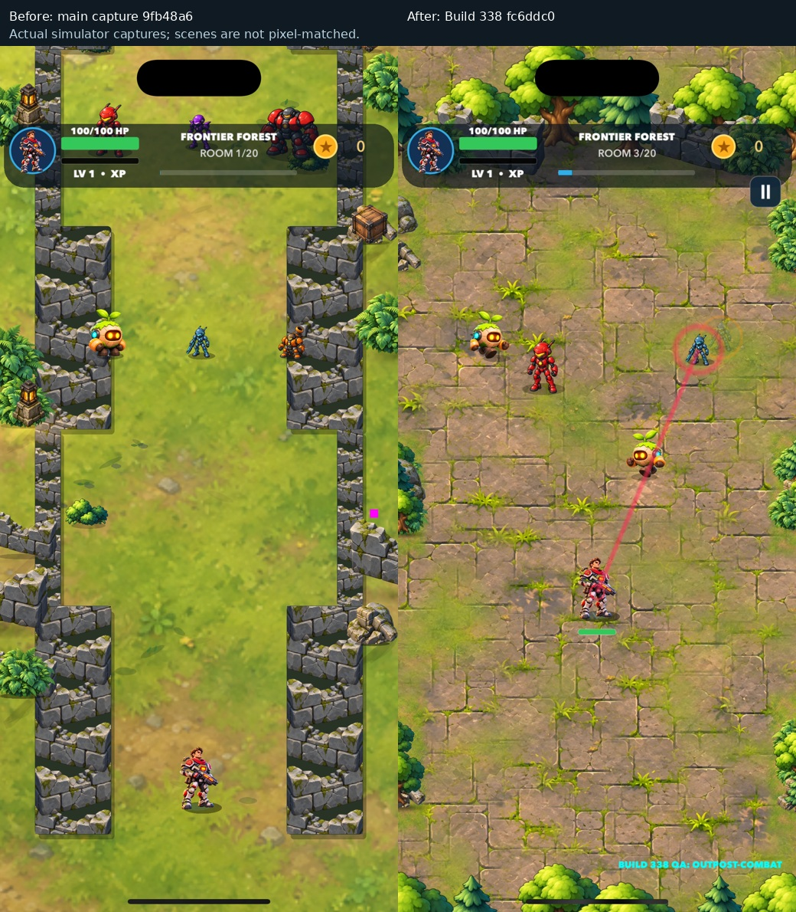
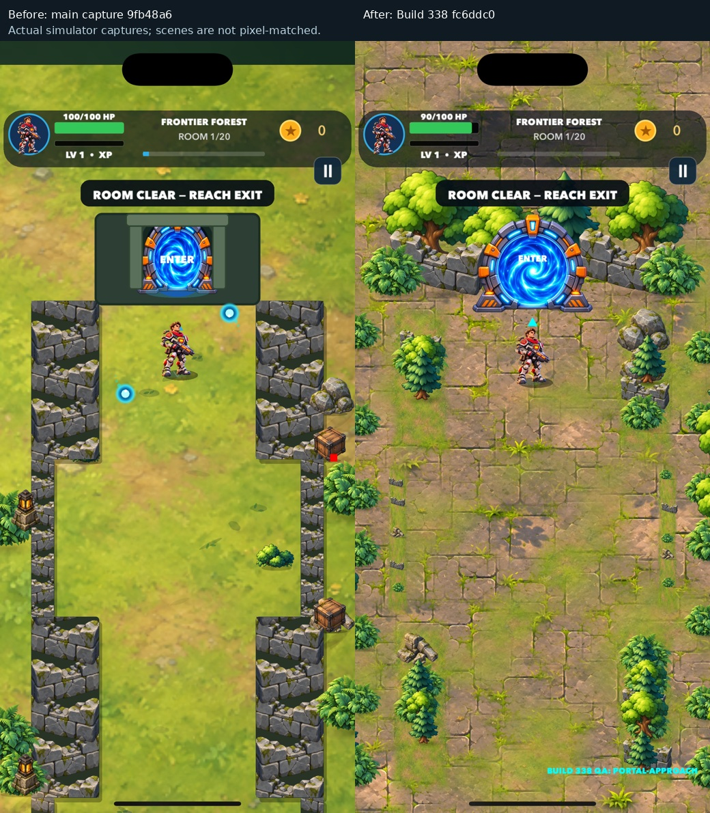
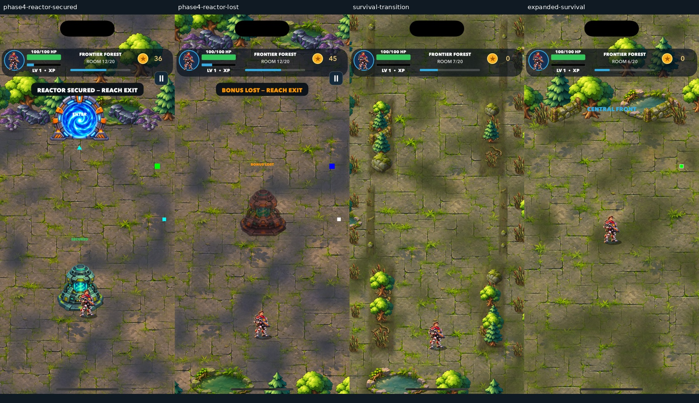

# Build 338 — environment overhaul and validation

**Branch:** `feature/build338-unified-world1`  
**Application/QA revision:** `eee6d3a6afecc301563ebf492279fb9a244aa590`  
**Baseline:** main `3987f2c11f3acac28f2dbbbb56098bd468d17d62`  
**Pull request:** [#11](https://github.com/JPaulus04/invasion-front-app/pull/11), draft. Nothing merged or uploaded to TestFlight.

## Result and release recommendation

World 1 now uses one renderer and a consistent overgrown stone/forest material system across all 20 rooms. All ten requested views were captured from the actual simulator and reviewed. The latest environment capture is `fc6ddc0`; subsequent application changes correct simulator fixtures and remove the duplicate resolved-reactor HUD headline. The final four-fixture milestone passed at the application/QA revision above; its secured/lost, 6→7 transition and expanded survival PNGs were also inspected.

**Hold TestFlight readiness and release signoff.** The full campaign trial timed out before the app started on both the initial disposable device and its single recovery device. A complete twenty-room dynamic run, physical-device frame time/memory, and compact-device visual review remain required. The branch is ready for code and art review. No 9.5/10 rating or exact match to an unavailable external approval board is claimed.

## Root causes and architecture

The old presentation stretched small 512×768 family paintings over entire rooms, layered several environment owners, repeated masonry courses along rectangular collision shoulders and forced the approved portal into a square beneath procedural framing. Existing polished forest art was mostly missing from the visible composition.

`WorldOneEnvironmentPlan` now supplies one deterministic world-space description; `WorldOneEnvironment` is the sole World 1 scenery renderer. The old World 1 stretched floor/showcase composition, repeated masonry rails and procedural portal frame are removed. Other worlds and the home screen retain their existing systems. The new renderer builds scenery on room entry/resize, caches textures and keeps full scenery frames within existing solid shoulders or outside the movement rectangle. It creates no new walk-through masonry or decorative obstacles inside combat lanes.

Walkable ground uses 512-point cells with 1024-pixel materials: two source pixels per world point, independent of room dimensions. Four seam-compatible variants per theme avoid identical neighbors. Source paving, moss, grass and soil are blended into the materials; they are not separate grass stamps. Reflected quadrants that produced paired paving seams in the first capture were removed. Forest soil uses baked feathered alpha because SpriteKit crop masks produced hard-edged panels/lobes. Trees mix species, scale and root positions rather than forming repeated vertical columns.

Six tactical proportions preserve approximately the original room-area budget and provide different path/pocket silhouettes. Survival, defense and Root Lord retain their authored geometry and objective anchors. Collision, spawn exclusion and navigation continue to share `WorldOneRoomGeometry`/`TerrainHazards`. Resize now rebuilds collision patches even when their separate drawing nodes are absent.

## Exact artwork ledger

All original `OutpostZero/ArtAssets` files and Mossbot animation assets are unchanged from main. Approved source files were retained.

| Asset | Use/change |
| --- | --- |
| `world1_overgrown_stone_arena.png` | Existing 1536×1024 uploaded painting; crop `(280,200,1256,824)` supplies paving/moss/grass without baked walls or gate. Upload commit `41f8e8bfb85e8c815217f97995736ae897655a0c`. |
| `world1_{ruined_outpost,swamp_basin,toxic_caves,boss_arena}_floor_1` | Existing family soil/wear source and feathered understory. |
| `build338_ground_{outpost,swamp,caves,sanctuary}_{0...3}` | 16 added 1024×1024 RGBA derived material imagesets. |
| `build338_understory_{outpost,swamp,caves,sanctuary}` | Four added feathered-alpha soil imagesets, derived from the existing family artwork. |
| `forest_pine_polished`, `forest_broadleaf_polished` | Restored surrounding forest and rooted grove sprites at measured ground anchors. |
| `world1_{ruined_outpost,swamp_basin,toxic_caves,boss_arena}_{wall,boulder,vegetation,debris}` | Existing authored boundary and portal-flanking ruins/plants. |
| `build338_forest_pool` | One new reusable generated transparent 640×426 pool component matching the source treatment. It supplements existing art, rather than replacing the approved landscape. |
| `outpost_zero_portal_approved_transparent.png` | Exact approved 1156×943 source retained; uniform aspect, grounded base, transparent background and authored far-wall masonry. |

[Ground provenance](ground-provenance.json) pins input/output hashes, crop and scale. [Approved portal baseline](approved-assets.json) pins the unchanged source hash. [Material source preview](derived-materials-source-preview.jpg) is asset provenance, not gameplay evidence.

Xcode changes loose PNG packaging to CgBI. The compiled-bundle verifier checks exact alpha and premultiplied visible colors against the approved source; the reviewed bundle has **zero visible-channel error**. Four regression tests accept ordinary/CgBI packaging and reject changed alpha/colors. Debug manifests now record `OutpostZero.debug.dylib` and other code payload hashes; the stable Debug launcher stub alone does not identify game code.

## Four cohesive areas

| Area | Rooms | Composition |
| --- | --- | --- |
| Ruined Outpost | 1–5, 16 | Warm reclaimed paving, mixed forest groves, broken defensive masonry and varied combat pockets. |
| Swamp Basin | 6–10, 17 | Damp moss-heavy stone, reeds, shallow exterior water shelves and open survival space. Forest gaps follow the actual pool footprints. |
| Toxic Caves | 11–15, 18 | Dark fractured paving, purple corrupted vegetation/rock formations and green-tinted exterior pools. Room 12 retains the dedicated reactor layout. |
| Sanctuary | 19–20 | Warmer weathered paving and ancient forest ruins surrounding a broad, readable Root Lord clearing. |

The areas share paving proportions, root anchoring, perspective and lighting treatment. Atmospheric pools remain outside the playable bounds; World 1's existing hazard-free balance is preserved.

## Portal, camera and objectives

The approved ring renders at a uniform aspect ratio, between authored far-wall ruins, with its base aligned to the ground. Rectangular jamb/lintel/mortar overlays are gone. The transparent fill and corrected `portalRecessEnergy` identifier from main are preserved. The separate timed-survival rescue orb retains its existing encounter purpose.

Camera zoom and character scale are unchanged. Horizontal exterior allowance exposes forest scenery. An unlocked distant portal no longer pushes the pilot below the viewport; portal headroom applies once pilot and gate can fit together, keeping the gate visible on approach. Tests check actual approach visibility and HUD separation. The reactor retains its authored center, integrity readout, grounded collision and occlusion. Its resolved-state exit banner is now the sole HUD result headline, avoiding the overlap found in the extra fixture review.

## Actual screenshot review

[Latest full-resolution video/PNG artifact](https://github.com/JPaulus04/invasion-front-app/actions/runs/43788243531/artifacts/14192041811) — `fc6ddc0`, iPhone 16 Pro simulator, iOS 18.5. [Reviewed frame selection](reviewed-frames.json) identifies all ten views by their visible stage badges. Home/launch frames are excluded from the selected set. These are actual frames extracted from `simctl recordVideo`; no scene reconstruction or generated preview is used as gameplay evidence.

Reviewed: outpost entrance and active combat; swamp; tactical caves; active reactor; Root Lord; far-wall portal; approach; long-room movement; real 1→2 exit transition. The images show continuous paving scale, blended soil, distinguishable area palettes/props, exterior water/forest, readable reactor integrity and boss name/health, and clear portal/player/HUD separation. The tour runs real enemy movement/attacks. It deliberately stages room entry and is **not** a complete campaign playthrough.

Before images come from successful main run [43768308294](https://github.com/JPaulus04/invasion-front-app/actions/runs/43768308294), commit `9fb48a6fd91e92136fc7408c7231de44b6a479c6`. They predate main's `3987f2c` portal-transparency cleanup. Comparisons are presentation comparisons with different room/pose states, not pixel-matched regression captures; Build 338 does not take credit for main's transparency fix.

[Final state artifact](https://github.com/JPaulus04/invasion-front-app/actions/runs/43792426094/artifacts/14192954241) — `eee6d3a`. The resolved-reactor frames below verify the single result headline. The secured fixture intentionally poses the pilot in front of the reactor to test correct occlusion; the active-reactor tour view shows normal player/objective separation.

Colored identity squares, the CENTRAL FRONT label and tour footer are simulator-only fixture markers, absent from normal play.

## Validation outcomes

| Check/run | Actual outcome |
| --- | --- |
| Local source and Python suite | Passed, 57 tests. Includes actual PNG decoding, source/output hashes, compatible material edges, alpha blending, approved portal pixels and simulator failure handling. |
| [Final environment milestone 43788243531](https://github.com/JPaulus04/invasion-front-app/actions/runs/43788243531), `fc6ddc0` | **Passed:** source/Python/native suites, iOS compile, 81-resource compiled-bundle verification, complete live tour, extracted PNGs. All ten requested views reviewed. |
| [Fixture milestone 43790829947](https://github.com/JPaulus04/invasion-front-app/actions/runs/43790829947), `96a6628` | **Passed:** corrected reactor-loss approach/HUD assertions, real survival 6→7 transition and live expanded survival rendering. All three screenshots inspected; their duplicate resolved-reactor headline motivated the final HUD fix. |
| [Final state milestone 43792426094](https://github.com/JPaulus04/invasion-front-app/actions/runs/43792426094), `eee6d3a` | **Passed:** 57 Python tests, native suites, iOS compile, compiled-bundle/pixel checks, reactor secured/lost assertions and captured PNGs, real survival 6→7 transition and expanded survival renderer. All four images reviewed. |
| [Full milestone 43786847936](https://github.com/JPaulus04/invasion-front-app/actions/runs/43786847936), `5e72076` | **Cancelled/incomplete:** compile/native tests passed. Stationary seed 335 batch 2 failed before launch on two fresh devices. No campaign result. Other queued/running trials were stopped to avoid runner cycling. Presentation produced six validated frames before the stale reactor-loss fixture assertion; that assertion is corrected and revalidated separately. |

Native tests cover all 20 deterministic environment plans, full-frame scenery clearance, safe spawn candidates, continuous entry-to-exit navigation, tactical area budgets, fixed material variants and camera/portal/player headroom at 320×568, 393×852 and 768×1024. Animation, replay, reactive-driver and pacing suites also passed. Bundle checks cover 81 compiled catalog names, including all 40 Mossbot frames, plus approved loose portal/tree/reactor/boss resources.

The failed campaign's [diagnostic artifact](https://github.com/JPaulus04/invasion-front-app/actions/runs/43786847936/artifacts/14190973578) records `started:false`, no PID, empty gameplay logs, `app_proven_absent:true`, no crash reports, and a 120-second initial-launch timeout on both the first and recovery device. This is pre-gameplay launch infrastructure failure, not a measured win/loss or a campaign pass. The earlier handoff run [43680764511](https://github.com/JPaulus04/invasion-front-app/actions/runs/43680764511) also failed capture; it was never treated as visual approval.

Draft PR updates now run compilation/tests without starting the broad simulator matrix. Ready-for-review PRs and explicit full milestones retain every existing campaign, defense and presentation check. The targeted fixture milestone uses one disposable device, bounded commands and no outer simulator retry loop. Skipped/cancelled tests are not acceptance evidence.

## Remaining verification and risks

- Run a complete moving World 1 campaign on a physical iPhone: traversal through both tactical pockets, edge collision/dodging, melee/ranged/flank arrivals, survival evacuation, reactor secured/lost and Root Lord victory. The full dynamic campaign remains unverified.
- Review compact-iPhone and iPad presentation in real gameplay. Those viewport sizes have native geometry coverage, not fresh visual approval.
- Profile frame time and memory on an older supported iPhone. All newly added RGBA texture inputs total about 71 MiB uncompressed if resident together, before platform texture optimization and image-cache overhead. No physical-device performance claim is made.
- The repository's uploaded arena/portal artwork is available and used. No separate external approval board was attached; exact agreement with that external reference cannot be certified. Final art review should confirm the open-room composition and material variation against that board if available.

## Commits

- `eee6d3a6afecc301563ebf492279fb9a244aa590` — [fixture-review] Remove overlapping reactor-result HUD headlines
- `96a6628ca29750d2e4109c1ec125e0f0d9799d71` — [fixture-review] Align reactor exit and survival capture assertions with the authored camera
- `fc6ddc01f02e6385a3b35078695f10b00dbdd416` — Keep wetland forest framing outside the actual pool shelves
- `5e72076229643dc5e2c99aebd6bb92688159ca35` — Blend authored forest soil, stagger foliage and synchronize visual capture readiness
- `f4b3823a8f77e4acd4a340dfc5e8d6f08a97fb1c` — Verify approved portal pixels through Xcode PNG optimization
- `f9f840b69181b5ea06093337dedc310faf2ef729` — Validate approved portal sprite in focused capture and stop on scene assertions
- `6128700825912fc57a9c40de36c475b2317647ef` — Polish captured forest edges, remove mirrored paving and expose water shelves
- `26f3ed0e030823661948689692af252d513f68bd` — Document Build 338 architecture, restored assets and review gates
- `380171f5c698012ff08343544bddabb005cbdc25` — Fix legacy scenery branch and expose forest camera margins
- `0d51ea2a85f073a0b3b4aee5c1131e879b12a82c` — feat(build338): restore approved forest-ruin materials with a unified World 1 renderer
